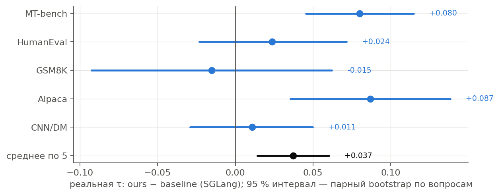
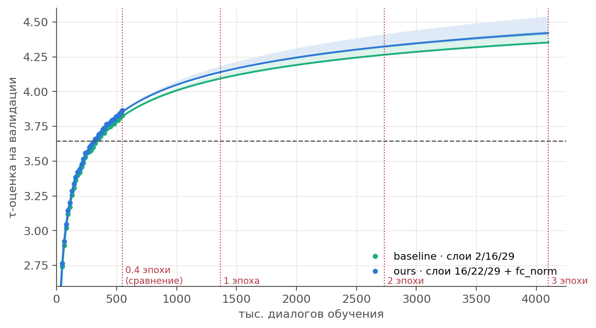

# Обучение драфта EAGLE-3 с нуля: слои статьи против наших

**Вопрос.** Станет ли драфт EAGLE-3 лучше, если подавать ему слои, найденные в [выборе слоёв](../layer-selection/), и нормировать вход `fc`? Проверяем на обучении с нуля, а не на дообучении: так у слоёв статьи нет форы.

**Что сделали.** Обучили два драфта для LLaMA-3.1-8B-Instruct с нуля на одной H200. Код авторов, данные, порядок данных и точка остановки у них одинаковые: 546 600 диалогов, это 0,4 эпохи. Различается только вход драфта:

| вариант | слои цели | перед `fc` |
|---|---|---|
| `baseline` — как в статье | 2, 16, 29 | — |
| `ours` — наш | 16, 22, 29 | `fc_norm` (RMSNorm на каждый слой, как в EAGLE-3.1) |

- **Данные:** PerfectBlend-Regenerated-Llama-3.1-8B-Instruct, 1,37 млн диалогов; ответы сгенерированы самой LLaMA.
- **Валидация:** каждые 16 тыс. диалогов, на одних и тех же 400 отложенных диалогах.
- **Итоговая оценка:** реальная τ и ускорение в SGLang и в коде авторов.

**Отчёты:** [результаты](reports/eagle3_big_training_results.pdf) · [почему `ours` не учился рецептом NeMo](reports/eagle3_nemo_incident.pdf).

## Что получилось

- **`ours` лучше `baseline` по реальной τ в SGLang.** В среднем по пяти бенчмаркам +0,037, 95 % интервал [+0,014; +0,060], это +0,65 %. Выигрыш сосредоточен в диалогах: MT-bench +0,08, Alpaca +0,09, оба значимы. На коде, математике и пересказе разница в пределах шума.
- **Код авторов подтверждает это:** MT-bench +0,06, HumanEval +0,05, GSM8K −0,03.
- **На валидации `ours` впереди во всех 35 точках из 35** при равном числе диалогов. Разница растёт с +0,025 до +0,031; в точке сравнения 3,865 против 3,828.
- **`ours` тратит меньше данных:** чтобы выйти на ту же τ, `baseline` нужно на 8–15 % больше диалогов.
- **Скорость та же:** `fc_norm` ничего не стоит. Ускорение в SGLang 2,91× у `ours` и 2,90× у `baseline`.
- **Нашли и исправили баг SGLang 0.5.9.** Драфт со слоями не по умолчанию получал в CUDA-графах слои 2/16/29, и τ `ours` падала на 13 %. Исправление в `code/sglang_eagle31`, подробности ниже.

### Реальная τ и ускорение

SGLang 0.5.9, дерево статьи 8 / 10 / 60, T = 0, batch 1, по 80 вопросов. В скобках — τ в коде авторов.

| драфт | MT-bench | HumanEval | GSM8K | Alpaca | CNN/DM | среднее τ | ускорение |
|---|---|---|---|---|---|---|---|
| официальный (авторы, ShareGPT + UltraChat) | **6,11** (6,18) | 6,69 (6,74) | 6,18 (6,26) | **6,63** | **5,34** | **6,19** | **3,06×** |
| `baseline`, 0,4 эпохи PerfectBlend | 4,95 (4,98) | 7,54 (7,56) | **7,41** (7,43) | 4,71 | 3,96 | 5,71 | 2,90× |
| `ours`, 0,4 эпохи PerfectBlend | 5,03 (5,04) | **7,56** (7,61) | 7,39 (7,41) | 4,80 | 3,97 | 5,75 | 2,91× |

- **На коде и математике** оба наших драфта уже за 0,4 эпохи сильнее официального: ускорение 3,76× против 3,36× на HumanEval.
- **На диалогах и пересказе** они слабее. Это разница данных обучения, а не архитектуры.

## Что это значит

- **Наши слои и `fc_norm` полезны и при обучении с нуля.** Выигрыш небольшой, но устойчивый: он виден с первых 16 тыс. диалогов, не исчезает к концу и подтверждается на реальной генерации.
- **Больше всего он помогает на диалогах.** На MT-bench и Alpaca наш драфт растёт сильнее, чем на коде и математике, где τ уже высокая.
- **Перенос в движки работает.**
  - `code/export.py` пишет веса для SGLang и NeMo/vLLM в их нумерации слоёв: индексы на 1 меньше наших.
  - Для SGLang 0.5.9 нужен внешний пакет `code/sglang_eagle31`: он добавляет `fc_norm` и исправляет захват слоёв.
  - После исправления SGLang и код авторов совпадают для всех трёх драфтов с точностью 0,08.
- **Рецепт NeMo AutoModel для этой задачи нестабилен:** растут логиты внимания. Подробности — в [отчёте](reports/eagle3_nemo_incident.pdf).

### Баг SGLang 0.5.9: слои цели в CUDA-графах

Слои, которые SGLang захватывает у целевой модели, задаются в конфиге драфта (`eagle_aux_hidden_state_layer_ids`). Проблема в порядке инициализации:

1. `CudaGraphRunner` перед записью графов вызывает `set_eagle3_layers_to_capture()` без аргументов. В графы decode и проверки дерева записываются слои по умолчанию 2, N/2, N−3.
2. Слои из конфига драфта выставляются только после этого. Они действуют лишь в prefill, который идёт без графов.

Для драфтов со слоями по умолчанию (официальный, `baseline`) ошибка незаметна. `ours` же в каждом раунде проверки получал слои baseline: τ 4,99 вместо 5,75 в среднем, MT-bench 4,36 вместо 5,03.

Исправление — две подменённые функции в `code/sglang_eagle31/llama_eagle3_fc_norm.py`: вызов без аргументов берёт слои из конфига драфта, которые к этому моменту уже прочитаны. В логе сервера видно `target layers to capture (output ids) [15, 21, 28], also in CUDA graphs`. Замер с ошибкой сохранён в `results/llama31-8b/final_eval/ours_sglang_capture_bug/`.

## Сколько ещё учить

Кривые валидации хорошо описываются законом

$$\hat\tau(n) = a - b\,n^{-c},\qquad c \approx 0{,}22$$

где $n$ — тысячи диалогов. Закон подогнан по трём окнам, в скобках — разброс между ними.

| τ-оценка на валидации | 0,4 эпохи | 1 эпоха | 2 эпохи | 3 эпохи |
|---|---|---|---|---|
| `baseline` | 3,83 (замер) | 4,09 (4,09–4,12) | 4,26 (4,26–4,33) | 4,35 (4,35–4,44) |
| `ours` | 3,87 (замер) | **4,14** (4,13–4,18) | **4,32** (4,31–4,41) | **4,42** (4,41–4,54) |

- **Отдача от данных падает медленно:** каждое удвоение добавляет 0,22 → 0,19 → 0,17. Драфт далёк от насыщения, а разрыв `ours` и `baseline` по прогнозу растёт.
- **τ-оценку 4,0** `ours` наберёт за 0,81–0,87 млн диалогов, `baseline` — за 0,92–0,98 млн.
- **Прогноз скорее занижен:** в точке сравнения lr ещё высокий, а отжиг lr к концу эпохи обычно добавляет сверх кривой.
- **Цена:** до конца эпохи около 23,5 ч H200 на вариант, это три 8-часовые сессии.
- **Чтобы обогнать официальный драфт на диалогах,** в первую очередь нужен другой состав данных (ShareGPT, UltraChat), а не только больше шагов.

## Что дальше

1. Дотянуть оба варианта до конца первой эпохи: на этом участке отожжётся lr.
2. Добавить в обучение диалоговые данные, чтобы догнать официальный драфт на MT-bench и Alpaca.
3. Отправить исправление захвата слоёв в SGLang upstream.

## Файлы

- `reports/` — PDF-отчёты.
- `figures/` — графики. Их строят:
  - `code/make_results_figures.py` — результаты;
  - `code/make_incident_figures.py` и `code/make_diag_figure.py` — инцидент NeMo.
- `results/llama31-8b/` — данные:
  - `baseline/`, `ours/`: история валидации (`val.jsonl`), хвост лога обучения (`metrics.jsonl`), итоговый статус;
  - `final_eval/`: реальная τ по вопросам в SGLang для всех драфтов и обычного сервера, итоги кода авторов; собирает `code/collect_final_eval.py`;
  - `reference.json`: официальный драфт на нашей валидации;
  - `results.json`, `tables.md`: все числа отчёта;
  - `nemo_incidents/`: логи срывов NeMo.
- `code/` — обучение, мониторинг (Telegram-бот, ClearML) и итоговая оценка. Как запускать — в [code/README.md](code/README.md).

Модели и чекпоинты в git не хранятся, они лежат на GPU-сервере.
