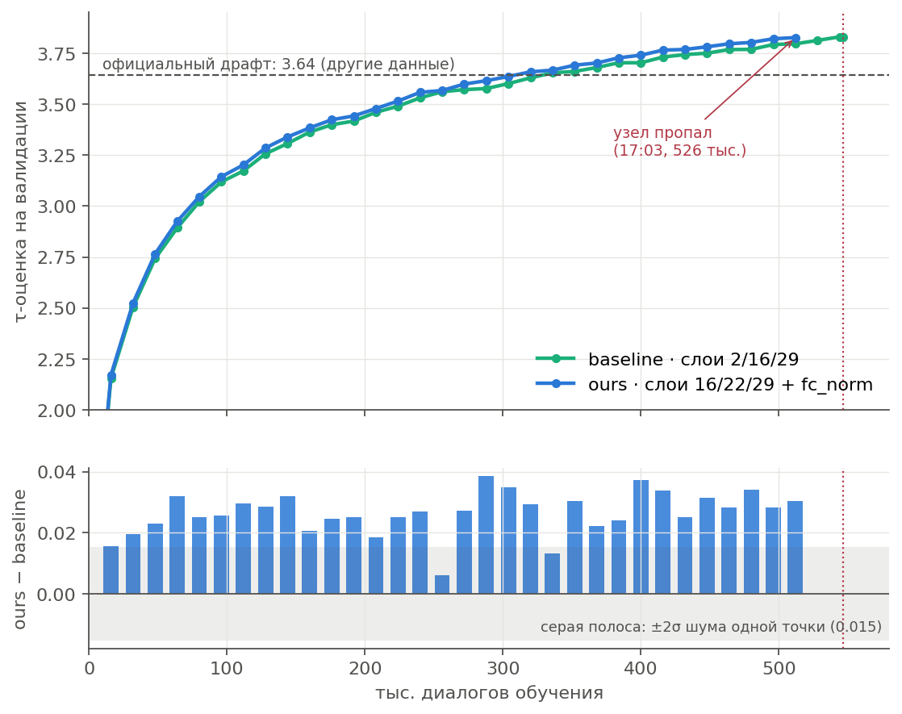

# Обучение драфта EAGLE-3 с нуля: слои статьи против наших

**Вопрос.** Будет ли драфт EAGLE-3 лучше, если подавать ему слои, найденные в [выборе слоёв](../layer-selection/), и нормировать вход `fc`? Проверяем при обучении с нуля, а не дообучении: так у слоёв статьи нет форы.

**Что сделали.** Обучили два драфта для LLaMA-3.1-8B-Instruct с нуля на одной H200. Код авторов, данные и порядок данных одинаковые, точка остановки тоже: 546 600 диалогов, 0,4 эпохи. Различается только вход драфта:

| вариант | слои цели | перед `fc` |
|---|---|---|
| `baseline` — как в статье | 2, 16, 29 | — |
| `ours` — наш | 16, 22, 29 | `fc_norm` (RMSNorm на каждый слой, как в EAGLE-3.1) |

Данные — PerfectBlend-Regenerated-Llama-3.1-8B-Instruct: 1,37 млн диалогов, ответы сгенерированы самой LLaMA. Каждые 16 тыс. диалогов оба варианта проверялись на одних и тех же 400 отложенных диалогах.

**Отчёты:** [результаты](reports/eagle3_big_training_results.pdf) · [почему `ours` не учился рецептом NeMo](reports/eagle3_nemo_incident.pdf).

## Что получилось

- **`ours` лучше `baseline` при равном числе диалогов во всех 32 точках валидации из 32.** Разница +0,025…+0,030 τ и со временем не тает. Это около 4σ шума одной точки.
- **`ours` тратит меньше данных:** чтобы выйти на ту же τ, `baseline` нужно на 6–9 % больше диалогов.
- **То же видно прямо на обучении.** На одних и тех же шагах и данных точность первого токена у `ours` выше на 0,23 п. п. Так в 247 строках лога из 249.
- **Реальная τ в SGLang** (дерево статьи, T = 0) измерена для официального драфта авторов и для `baseline`. Код авторов даёт те же числа, расхождение ≤ 0,08.
- **`ours` в SGLang измерить не успели:** 14.10 в 17:03 узел H200 пропал из сети, за 36 минут до точки сравнения. Пересчёт через валидацию даёт около +0,8 % к `baseline`. Это прогноз, а не замер.

### Реальная τ

| драфт | MT-bench | HumanEval | GSM8K | Alpaca | CNN/DM | среднее |
|---|---|---|---|---|---|---|
| официальный (авторы, ShareGPT + UltraChat) | **6,11** | 6,69 | 6,18 | **6,63** | **5,34** | **6,19** |
| `baseline`, 0,4 эпохи PerfectBlend | 4,95 | **7,54** | **7,41** | 4,71 | 3,96 | 5,71 |
| `ours`, прогноз | ≈ 4,99 | ≈ 7,60 | ≈ 7,47 | ≈ 4,75 | ≈ 3,99 | ≈ 5,76 |

SGLang 0.5.9, дерево 8 / 10 / 60, T = 0, по 80 вопросов. На коде и математике наш `baseline` уже сильнее официального драфта, на диалогах и пересказе слабее. Это разница данных обучения, а не архитектуры.

## Что это значит

- **Наши слои и `fc_norm` полезны и при обучении с нуля.** Выигрыш небольшой, но устойчивый: он есть с первых 16 тыс. диалогов и не уменьшается к концу.
- **Перенос в SGLang и NeMo.** `code/export.py` пишет веса в нумерации слоёв SGLang и NeMo (их индексы на 1 меньше наших). Для `fc_norm` в SGLang 0.5.9 сделан внешний пакет модели `code/sglang_eagle31`. Экспорт проверен на `baseline`: τ в SGLang совпала с кодом авторов. Замер `ours` в SGLang — первый шаг, когда вернётся узел.
- **Рецепт NeMo AutoModel для этой задачи нестабилен** (рост логитов внимания). Подробности — в [отчёте](reports/eagle3_nemo_incident.pdf).

## Сколько ещё учить

Кривые хорошо описываются законом

$$\hat\tau(n) = a - b\,n^{-c},\qquad c \approx 0{,}22$$

где $n$ — тысячи диалогов. Подгонка сделана по трём окнам; в скобках — разброс между ними.

| τ-оценка на валидации | 0,4 эпохи | 1 эпоха | 2 эпохи | 3 эпохи |
|---|---|---|---|---|
| `baseline` | 3,83 (замер) | 4,09 (4,09–4,12) | 4,26 (4,26–4,33) | 4,35 (4,35–4,44) |
| `ours` | ≈ 3,85–3,86 | **4,13** (4,12–4,16) | **4,30** (4,30–4,38) | **4,39** (4,39–4,50) |

- **Отдача от данных падает медленно:** каждое удвоение добавляет 0,21 → 0,18 → 0,15. Драфт далёк от насыщения.
- **Сколько нужно данных:** τ-оценку 4,0 `ours` наберёт за 0,83–0,88 млн диалогов, `baseline` — за 0,92–0,98 млн.
- **Прогноз скорее занижен:** в точке сравнения lr ещё высокий, а отжиг lr к концу эпохи обычно добавляет сверх кривой.
- **Цена:** до конца эпохи около 23,5 ч H200 на вариант, это три 8-часовые сессии.
- **Чтобы обогнать официальный драфт на диалогах,** нужен в первую очередь другой состав данных (ShareGPT, UltraChat), а не только больше шагов.

## Что дальше

1. Когда узел вернётся: доучить `ours` до шага 68 325 (≤ 40 мин) и запустить `code/final_eval_part2.sh` (≈ 1 ч). Он измерит реальную τ `ours` в SGLang и кодом авторов, ускорение и чистые скорости.
2. Дотянуть оба варианта до конца первой эпохи: здесь сработает отжиг lr.

## Файлы

- `reports/` — PDF-отчёты.
- `figures/` — графики. Их строят:
  - `code/make_results_figures.py` — все графики результатов;
  - `code/make_incident_figures.py` и `code/make_diag_figure.py` — инцидент NeMo.
- `results/llama31-8b/` — данные:
  - `baseline/`, `ours/` — история валидации (`val.jsonl`), хвост лога обучения (`metrics.jsonl`), итоговый статус;
  - `final_eval_part1.json` — реальная τ;
  - `reference.json` — официальный драфт на нашей валидации;
  - `results.json`, `tables.md` — все числа отчёта;
  - `nemo_incidents/` — логи срывов NeMo.
- `code/` — обучение, мониторинг (Telegram-бот, ClearML) и итоговая оценка. Как запускать — в [code/README.md](code/README.md).

Модели и чекпоинты в git не хранятся: они на GPU-сервере.
