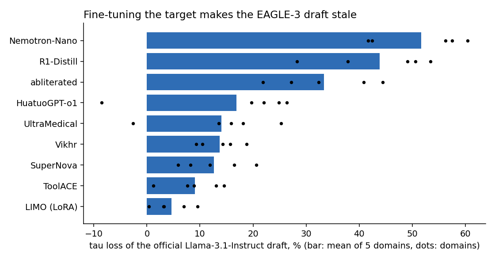
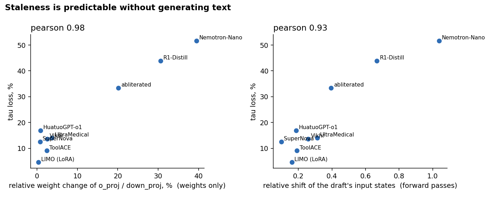
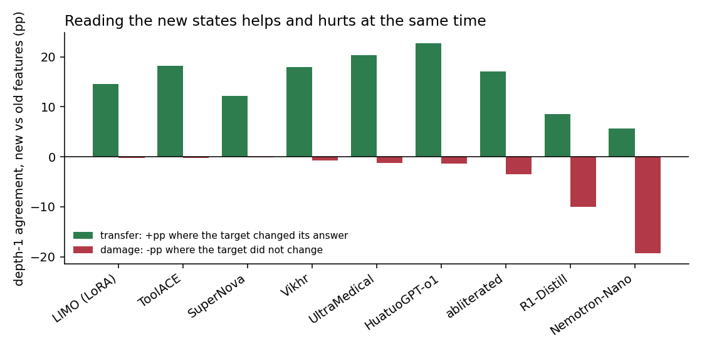
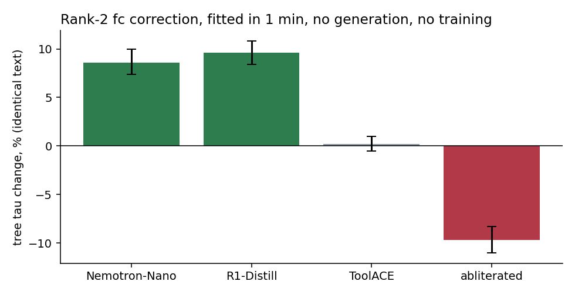

# Устаревание драфта после дообучения target

**Вопрос.** Большую модель (target) постоянно дообучают: LoRA под домены, полное дообучение, RL, дистилляция
рассуждений. Драфт EAGLE обучен под исходную модель и остаётся прежним. Насколько он устаревает, можно ли это
предсказать без генерации текста, почему драфт не подстраивается сам, хотя читает признаки target, и можно ли его
починить **без генерации новой моделью и без обучения драфта**?

**Что сделали.**
- Взяли официальный драфт EAGLE-3 для Llama-3.1-8B-Instruct и 9 публичных дообучений этой модели: от LoRA до
  дистилляции рассуждений. Плюс R1-Distill-Llama-8B со своим драфтом — это сравнение 2×2.
- Замерили настоящий τ дерева кодом авторов на 96 запросах: общие, математика, код, медицина, вызовы инструментов,
  русский.
- Разобрали, как меняются веса и скрытые состояния, и построили поправку входа драфта ранга 2, которая встраивается
  в его `fc`.

**Отчёты:** [отчёт, 6 страниц](reports/staleness_report.pdf) · [слайды](reports/staleness_slides.pdf) ·
[все таблицы](tables.md).

## Что получилось

- **Дообучение делает драфт устаревшим.** LoRA снимает 0–10 % τ, полное дообучение по домену — 10–26 % во всех
  областях, дообучение под рассуждения — **40–60 %**: ускорение падает с 2,34× до 1,5×. Свой драфт R1-Distill
  возвращает всё, значит дело в несоответствии драфта, а не в самой модели.
- **Это видно по одним весам.** Среднее относительное изменение матриц, пишущих в остаточный поток (`o_proj`,
  `down_proj`), коррелирует с потерей τ: **r = 0,98**, ρ = 0,87 на 9 моделях. По сдвигу скрытых состояний — r = 0,93.
  Оговорка: так надёжно отделяются тяжёлые изменения от лёгких, но умеренные не ранжируются.
- **Драфт не подстраивается сам по двум противоположным причинам.** Новые признаки передают драфту новое поведение
  модели: на токенах, где модель изменила ответ, драфт угадывает на 6–23 п.п. чаще. Но у тяжёлых изменений они же
  **искажают** работу драфта на токенах, где ответ прежний: до −19 п.п. Искажение — это поворот, а не масштаб; 75 %
  его драфт видит через слой 29, и оно почти одномерно.
- **Поправка ранга 2 в `fc`** подбирается за минуту по прямым проходам двух моделей, без генерации и обучения.
  На двух моделях с рассуждениями она даёт **+8,6 % и +9,6 % τ** (95 % интервалы выше нуля), на контроле +0,2 %.
  На abliterated −9,7 %: там искажение масштабное, а поправка рассчитана на поворот.
- **На русском драфт почти бесполезен у любой модели:** 56 % токенов ответа вне его словаря, τ 1,5–1,7.



## Подробнее

### 1. Карта

| target | тип изменения | средняя потеря τ (5 англ. областей) |
|---|---|---|
| LIMO | LoRA r8 | 4,7 % |
| ToolACE-8B | инструменты | 9,1 % |
| SuperNova-Lite | дистилляция | 12,6 % |
| Vikhr | русский | 13,7 % |
| UltraMedical | медицина | 14,0 % |
| HuatuoGPT-o1 | медицина, рассуждения | 16,9 % |
| abliterated | тяжёлое | 33,3 % |
| R1-Distill | дистилляция рассуждений | 43,9 % |
| Nemotron-Nano | рассуждения, SFT + RL | 51,7 % |

Полная таблица по областям, ускорение и сравнение 2×2 — в [tables.md](tables.md).

### 2. Предсказание без генерации

$$\rho_W=\operatorname{mean}_{W\in\{o,\,down\}}\frac{\lVert W_1-W_0\rVert_F}{\lVert W_0\rVert_F},\qquad
\delta=\mathbb E_t\frac{\lVert h_t(\theta_1)-h_t(\theta_0)\rVert}{\lVert h_t(\theta_0)\rVert}$$



### 3. Механизм

Токены общего текста делим на те, где дообученная модель сказала бы то же, что исходная ($S$), и где другое ($C$).
Совпадение драфта на первом шаге $a_X(f)$ с признаками старой ($f^0$) или новой ($f^1$) модели:

$$T=a_C(f^1)-a_C(f^0)\ \text{(перенос)},\qquad D=a_S(f^0)-a_S(f^1)\ \text{(искажение)}$$



### 4. Поправка

Для каждого читаемого слоя $j$ берём средний сдвиг и главное направление сдвига, $P_j\in\mathbb R^{2\times4096}$,
и ridge-регрессией предсказываем, насколько вернуть эти две координаты по всему новому состоянию:

$$x'=x+[x,1]R_jP_j=x\,(I+A_j)+c_j,\qquad W_{fc}'=W_{fc}\,\mathrm{blockdiag}(I+A_j^\top),\qquad b_{fc}=W_{fc}[c_2;c_{16};c_{29}]$$

Подгонка — по прямым проходам исходной и новой модели на 24 текстах исходной модели. Вариант зафиксирован до
проверки τ по 30 вариантам на первом шаге драфта.



Сравнение — на общем начале ответов с поправкой и без, до первого расхождения. EAGLE в bf16 иногда иначе разрешает
почти равные варианты, поэтому тексты совпадают не всегда.

## Что это значит

- Без обучения драфта можно заранее понять, что он устарел, и для изменений типа «рассуждения» бесплатно вернуть
  около 10 % τ. Это «первая помощь», а не замена переобучению: свой драфт R1-Distill даёт +100 %.
- Ответ на исходную идею «получить поправку драфта только из весов изменения» пока отрицательный. Простые поправки в
  замкнутой форме по весам не работают, а поправка, специфичная для изменения, многомерна. Работает только
  восстановление входа по прямым проходам.

## Ограничения и что дальше

- Одна база и один драфт; по 16 запросов на область; поправка проверена на 4 изменениях, правило «включать при
  $\cos(u^0,u^1)<0{,}9$» выведено задним числом. Ускорение по времени оценено через τ.
- **Дальше:** заранее объявленная проверка на 2–3 новых моделях с рассуждениями вместе с замером скорости (около
  1,5 ч A100); вторая семья моделей (Qwen3-8B); поправка, учитывающая масштаб (для abliterated); направления поправки
  из весов.

## Файлы

| путь | что |
|---|---|
| `code/staleness.py` | карта: τ дерева, словарь, ускорение (`config.py` — модели и протокол) |
| `code/decompose.py` | разложение на цепочке: новые против старых признаков на тексте новой модели |
| `code/geometry1.py`, `geometry1b.py`, `geometry1c.py`, `geometry1d.py` | сдвиг состояний, веса, восстановление входа, первый шаг драфта |
| `code/fixfc.py` | поправка в `fc` и τ дерева с ней |
| `code/analysis_*.py`, `analyze.py`, `make_figures.py` | анализ без GPU и графики |
| `code/colab/` | доступ к Colab через официальный CLI: сессия, ssh, загрузка кода, пинг ядра и выгрузка результатов |
| `results/llama31-8b/` | все JSON (с ответами моделей), компактные `npz`, логи прогонов (`runs/`), выводы анализа (`analysis/`) |

**Запуск.** Нужна GPU от 40 ГБ и интернет (Hugging Face).

```bash
bash code/setup.sh
```
```bash
.venv/bin/python code/staleness.py
```
```bash
.venv/bin/python code/fixfc.py nemotron_nano r1_distill abliterated toolace
```

Анализ без GPU — из папки направления:

```bash
python code/analysis_mechanism.py
```

Полные состояния шага `geometry1b` (~34 МБ на модель) в git не хранятся; без них часть разделов
`analysis_weights.py` и `analysis_mechanism.py` пропускается, числа этих разделов — в `results/llama31-8b/analysis/`.
