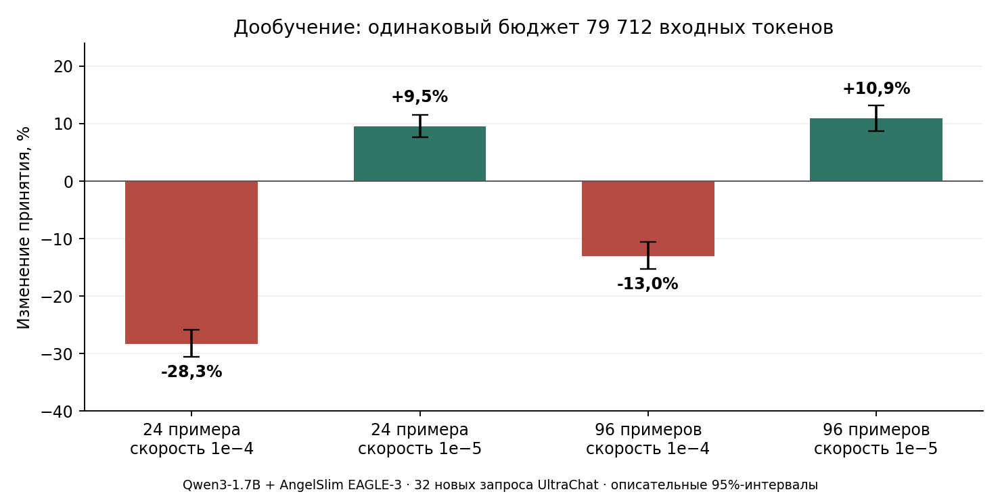

# Память обучения и малобюджетное дообучение EAGLE-3

Эксперименты Георгия Мамарина, 7–8 октября 2026 года. Обучение адаптировано из закреплённого кода NeMo, оценка принятия деревьев построена на SafeAILab/EAGLE. Это отдельная экспериментальная реализация для Qwen3-1.7B.

**Два результата:** общий буфер вероятностей снизил пик памяти на 14–16% на длинных формах; небольшое дообучение готового драфта со скоростью `1e−5` улучшило принятие токенов на новых запросах на 9,5–10,9%. Ускорение реальной генерации в серии дообучения не измерялось.



На графике парные изменения к исходному драфту и описательные 95%-интервалы по 32 запросам. Основные критерии и интервалы с поправкой на три сравнения приведены в [протоколе](reports/PROTOCOL.md) и [результатах](reports/RESULTS.md).

## Что проверяли

| Вопрос | Опыт | Результат |
|---|---|---|
| Можно ли убрать копии вероятностей между шагами TTT? | Общий буфер со срезами, затем ядро Triton для пакета из нескольких последовательностей | Пик ниже на 14,4% при длине 640 и на 16,2% при 1024; максимальная проходящая длина сетки под лимитом 6 ГиБ выросла с 640 до 768 |
| Помогает ли дольше обучать готовый драфт на 24 примерах? | Срезы после 0/1/4/16 эпох при постоянной скорости `1e−4` | После 16 эпох принятие на обучающих запросах +34,1%, на проверочных −30,3%: локальный признак переобучения |
| Что сильнее влияет: объём корпуса или скорость обучения? | 24/96 примеров × `1e−4`/`1e−5`, по 79 712 входных токенов | При `1e−5`: +9,5% и +10,9% к готовому драфту; при `1e−4`: −28,3% и −13,0% |

## Модели, данные и объём

- Целевая модель `Qwen/Qwen3-1.7B`; готовый драфт `AngelSlim/Qwen3-1.7B_eagle3`. Обновлялись 136 847 360 параметров драфта в 13 тензорах, включая унаследованную входную матрицу. Целевая модель и её представления токенов заморожены.
- Признаки взяты с выходов блоков `[1,13,24]`, при нумерации с нуля. Это входы блоков `[2,14,25]`; выбор слоёв не менялся.
- Дообучение: UltraChat, 96 уникальных обучающих запросов, 8 прежних проверочных и 32 новых проверочных. Набор из 24 входит в 96. Ответы генерировал Qwen3-1.7B без рассуждений, жадным выбором токена, с естественной остановкой и пределом 128 новых токенов. Готовые ответы UltraChat не использовались.
- Четыре условия получили суммарно 318 848 входных токенов и 1 530 обновлений. Пакет из одной последовательности, 7 шагов TTT внутри обновления. Признаки и вероятности цели сохранены заранее. RTX 2070, 8 ГБ.
- Память: четыре синтетических технических документа, два для калибровки и два для проверки; пакет из двух последовательностей, 7 шагов TTT, длины 166–1024. T4, 16 ГБ.
- В обеих сериях вычисления FP16, основные обучаемые веса и состояния AdamW в FP32. Плотное вычисление потерь в опыте дообучения; оптимизации буфера и Triton туда не включались.

Полные версии, условия и границы метрик: [метаданные](results/qwen3-1.7b/experiment_metadata.json). Подробности: [протокол](reports/PROTOCOL.md), [результаты](reports/RESULTS.md).

## Что означают результаты

Снижение скорости обучения помогло сильнее расширения корпуса. При `1e−5` увеличение 24 → 96 даёт около 1,3% дополнительного принятия; это описательное сравнение. Настройка `1e−5` и бюджет 79 712 токенов дают исходный вариант для следующих сравнений отбора данных в проверенных условиях.

Общий буфер со срезами уже встречается в SpecForge. Здесь выполнены адаптация к исследованному пути NeMo, проверка градиентов и обновлений, измерение памяти и доработка адресации Triton. Происхождение кода указано в [THIRD_PARTY.md](code/THIRD_PARTY.md).

Принятие оценивали на одинаковых сохранённых ответах цели, деревом 64/2/10. Эта метрика отличается от цепочечной оценки и от реальной генерации деревом из статьи. Проверка полного совпадения EAGLE с обычной генерацией дала 14/16, поэтому зависимые замеры скорости остановлены. Калибровка счётчиков дала 14/14 на семи ранее корректных запросах; перенос этой калибровки на новые 32 отдельно не проверялся.

Один состав корпуса и порядок обучения, один начальный генератор случайных чисел. Повторные оценки не заменяют повторные обучения. Штатный рецепт NeMo с BF16 и FlashAttention и перенос экономии памяти на естественные данные не проверены.

## Как проверить

Из корня репозитория:

```bash
python3 training-efficiency/code/analyze_results.py
python3 training-efficiency/code/make_figures.py
```

Первая команда пересчитывает парные результаты и интервалы из сохранённых счётчиков, проверяет бюджет токенов и точность повторов. Модели и видеокарта ей не нужны. Для графиков нужен `matplotlib`.

Для небольших проверок на CPU с `torch` и `transformers`:

```bash
python3 training-efficiency/code/prepare_sources.py
python3 training-efficiency/code/check_cpu.py
```

Исходники NeMo и EAGLE скачиваются по закреплённым версиям с проверкой SHA-256 в игнорируемые папки. Команда скачивает только исходники. Состав исходников и границы воспроизведения: [code/README.md](code/README.md).

## Что дальше

1. Проверить готовые ответы UltraChat как источник обучающих сигналов при одинаковом бюджете.
2. Сравнить способы отбора данных при `1e−5`; подготовку признаков и отбор учитывать отдельно.
3. Проверить перенос на независимые задачи и повторные обучения.
4. Перенести общий буфер в штатный рецепт NeMo и проверить численную эквивалентность до замеров памяти и времени.
