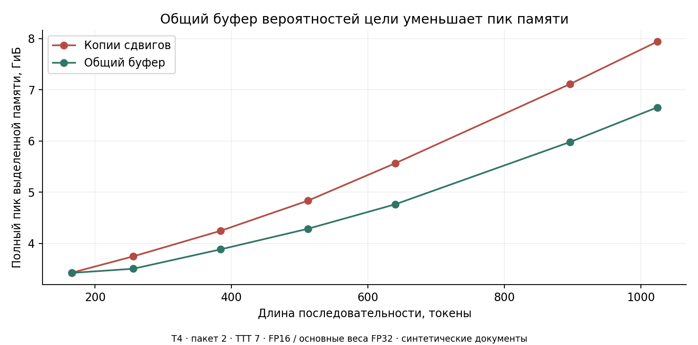

# Результаты 7–8 октября

## Малобюджетное дообучение

Qwen3-1.7B + готовый AngelSlim EAGLE-3. На четыре условия по 79 712 входных токенов, проверка на 32 новых запросах UltraChat. Общее принятие и парное изменение имеют разные способы усреднения.

| Корпус / скорость обучения | Общая τ по сумме токенов и циклов | Парное изменение к готовому драфту | Лучше / хуже / равно |
|---|---:|---:|---:|
| Готовый драфт | 2,7472 | 0% | 0 / 0 / 32 |
| 24 / `1e−4` | 1,9736 | −28,3% | 0 / 32 / 0 |
| 24 / `1e−5` | 3,0213 | +9,5% | 30 / 0 / 2 |
| 96 / `1e−4` | 2,3941 | −13,0% | 1 / 30 / 1 |
| 96 / `1e−5` | 3,0610 | +10,9% | 29 / 0 / 3 |

Все три заранее заявленных критерия прошли:

| Критерий | Среднее парное отношение | Интервал 98,3333% | Положительные запросы |
|---|---:|---|---:|
| H27: меньшая скорость | 1,3957 | [1,3555; 1,4353] | 32/32 |
| H28: больший корпус | 1,1083 | [1,0878; 1,1290] | 32/32 |
| H29: 96 / `1e−5` к готовому драфту | 1,1095 | [1,0828; 1,1359] | 29/32 |

При меньшей скорости прирост от расширения 24 → 96 составляет около 1,3%; отдельного подтверждающего критерия для него не задавали. Дообучение с `1e−5` даёт положительный исходный вариант для дальнейших сравнений отбора данных в этих условиях.

На условие обновления занимали около 65 секунд, пик обучения около 3,8 ГиБ. Подготовка 104 новых ответов цели заняла около 19 минут. Это расход выбранного протокола с генерацией ответов; его нельзя считать обязательной ценой обучения NeMo.

В одной фазе оценка прервалась при записи файла статуса после завершения всех 381 обновления. Полная оценка повторена с сохранённого контрольного состояния, без повторного обучения. Все 52 ранее полученных оценки и 64 строки диагностики совпали. Основные сравнения используют полную восстановленную оценку; исходный отказ сохранён в локальных артефактах. Компактные данные содержат 400 исполнений и 200 точных повторов.

Источник: [парные данные и анализ](../results/qwen3-1.7b/factorial_analysis.json), счётчики отдельных условий и обновлений в той же папке.

## Длительность обучения на 24 примерах

24 обучающих и 8 проверочных запросов, постоянная скорость `1e−4`, срезы после 0/1/4/16 эпох.

| Эпохи | τ на обучающих запросах | τ на проверочных запросах |
|---|---:|---:|
| 0 | 2,696 | 2,709 |
| 1 | 3,315 | 2,702 |
| 4 | 3,500 | 2,216 |
| 16 | 3,622 | 1,893 |

После 16 эпох парное принятие на обучающих запросах +34,1%, на проверочных −30,3%. Это локальный признак переобучения в выбранном режиме. Опыт 2×2 показал, что снижение скорости помогло даже на тех же 24 примерах. Единственную причину ухудшения эти результаты не устанавливают.

Источник: [анализ кривой](../results/qwen3-1.7b/learning_curve_analysis.json) и [счётчики](../results/qwen3-1.7b/learning_curve_replay.json).

## Память и Triton

| Проверка | Результат |
|---|---|
| Общий буфер | Пик ниже на 14,4% при 640 и на 16,2% при 1024; на короткой форме 166 только 0,13% |
| Вместимость при лимите 6 ГиБ | Максимальная проходящая длина сетки `dense` 640, `split`/`stride` 768: +20% |
| `stride` к `split`, длины 166/768 | 1,02336× / 1,02978×; оба критерия прошли |
| `stride` к `dense`, длины 166/768 | 1,03158× / 1,01995×; на 768 порог 1,02× не пройден |
| Состояния после обновления | Все 48 сравнений совпали: градиенты после ограничения нормы, основные веса, состояния AdamW, веса FP16 |
| Значения функции потерь | 41/48 побитно совпали; остальные прошли прежний допуск |
| Прогноз памяти | Общий критерий не прошёл: полный пик 7/8, все фазы 4/8, экономия 2/4 |

Общий буфер известен из SpecForge. Адаптация подтверждает пользу этого приёма в проверенном пути NeMo. Дополнительную вместимость дал буфер; изменение Triton её не увеличило. Вариант GQA ранее остановлен после отказа проверки градиентов готовой модели; зависимые замеры для него не запускались.

Источник: [анализ](../results/qwen3-1.7b/memory_analysis.json), [96 измерений](../results/qwen3-1.7b/memory_measurements.json), [численные проверки](../results/qwen3-1.7b/memory_checks.json).

## Границы результата

Полное совпадение генерации EAGLE с обычной генерацией: [14/16](../results/qwen3-1.7b/generation_correctness.json). Поэтому ускорение генерации не измерялось. [Калибровка счётчиков](../results/qwen3-1.7b/fixed_path_calibration.json) совпала в 14/14 случаях на семи ранее корректных запросах; на новых 32 отдельно не проводилась.

Один состав корпуса, порядок обучения и начальное состояние генератора случайных чисел. Независимые задачи и повторные обучения не проверены. Штатный BF16/FlashAttention рецепт NeMo не проверен.
